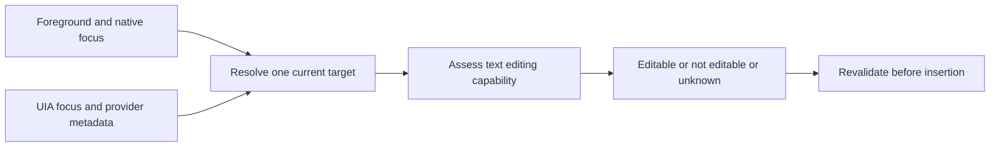

# Windows text target detection refactor proposal

Status: approved direction, 18 October 2026. The earlier tested Excel and logging fixes were committed and pushed first. The prototype passed the observed provider shapes; implementation and validation are tracked in [the implementation report](research/generic-text-target-implementation.md). The design and estimates below record the original proposal.

## Recommendation

Build one shared text-target module that resolves the current input target, assesses its text-editing capabilities, and reports **editable**, **not editable**, or **unknown**, with a reason. Replace application-class exceptions only after a prototype demonstrates equivalent focus resolution without application names. Keep the existing insertion mechanism initially.

The goal is to fix provider shapes once, across applications: embedded editors, native accessibility bridges, windowless controls, and delayed or contradictory focus. This is a broader change than adding control types to the current list. A UI Automation refactor can improve coverage substantially, but the public interfaces do not establish a universally reliable external detector. A native Text Services Framework service is a separate alternative if its stronger text-context contract is required.

## What the current design gets wrong

`engine/platform_win/editor_focus.py` mixes target discovery, provider recovery, and policy in a single path. `FocusedElement.can_dictate` reduces capability evidence to a control-type list and a read-only flag. Missing metadata and definite non-editability frequently have the same outcome and message.

The live Excel cases exposed three different failures: a writable DataItem was excluded; Copilot's outer native pane hid the focused inner editor; and Excel's native in-cell pane differed from its provider-backed Edit element. The existing EXCEL6/XLDESK recovery fixes the third case using application-specific knowledge.

There is also a distinction between **a value automation can change** and **the place keyboard text will go**. Microsoft documents ValuePattern on non-text values and on editable list/tree items regardless of their current editing mode. Therefore simply deleting the type list and accepting every writable ValuePattern would not establish safe keyboard insertion. The insertion implication is a design inference from those documented contracts. [Value pattern](https://learn.microsoft.com/en-us/windows/win32/winauto/uiauto-implementingvalue)

## Proposed module and interface

Keep platform details behind the existing editor-focus seam. Its public assessment contains a decision, a reason, and the resolved target identity needed for later validation. Callers should not choose between UIA patterns, inspect native class names, or implement their own fallback order.

```text
assess_current_target() -> TargetAssessment
revalidate_target(previous, anchor_scope) -> TargetAssessment

TargetAssessment:
    decision: editable | not_editable | unknown
    reason: stable diagnostic code
    target: resolved identity and bounds, when available
```

These are proposed interfaces, not additional public configuration. Private acquisition functions collect metadata; a deterministic classifier evaluates that metadata. Tests exercise the same assessment interface used by callers, with replaceable acquisition at an internal seam.



### Resolve the target before assessing it

1. Snapshot the foreground root and `GetGUIThreadInfo` native focus. Query UIA focus and the element associated with the native focus window. Native and UIA trees are different; a valid UIA control may have no HWND. [Native focus information](https://learn.microsoft.com/en-us/windows/win32/api/winuser/ns-winuser-guithreadinfo), [UIA properties](https://learn.microsoft.com/en-us/windows/win32/winauto/uiauto-automation-element-propids)
2. Resolve focused descendants within the current host. Require an unambiguous candidate consistent with the current focus snapshot. Do not select an arbitrary writable descendant or trust traversal order when multiple providers report focus. Microsoft supports subtree searches and recommends starting at lower containers. [Obtaining UIA elements](https://learn.microsoft.com/en-us/windows/win32/winauto/uiauto-obtainingelements)
3. Explore a small ancestor neighborhood only when the native host and accessibility provider disagree. Recovery must establish a relationship to the current native target, not merely membership in the same application window. Application executable names and class strings must not decide eligibility.
4. Check for focus changes before returning; retry once on a detected transition. Revalidate again at the existing insertion check. A stale or ambiguous result becomes unknown.

Step 3 is the principal **prototype gate**, not an already-proven algorithm. LegacyIAccessible can sometimes supply a containing HWND, but it may be unavailable and a shared containing window does not prove which child is focused. [MSAA access](https://learn.microsoft.com/en-us/windows/win32/winauto/uiauto-accessingmsaaservers), [WindowFromAccessibleObject](https://learn.microsoft.com/en-us/windows/win32/api/oleacc/nf-oleacc-windowfromaccessibleobject)

In a metadata-only probe of this session's resolved Excel editor, UIA returned no native HWND and the legacy-accessibility route produced no IAccessible object. Native focus/caret were also unavailable while the user was in chat, so that portion did not test an active Excel focus snapshot. This means the MSAA mapping route has **not** demonstrated a general replacement for the Excel exception. The prototype must evaluate fresh focus events and provider relationships while the target is active; if those cannot disambiguate it, this route must not be presented as solved.

### Assess capabilities without application names

| Evidence | Decision rule |
|---|---|
| Disabled, password, or explicitly read-only target/range | Not editable under the existing product policy |
| Verified current text-input target with an explicit writable value or insertion range | Editable |
| Merely focusable, a pane, a writable non-text value, or text exposure alone | Insufficient evidence |
| Unsupported/mixed attributes, contradictory focus, missing provenance, or provider failure | Unknown |

Control roles remain supporting evidence about text semantics, rather than a universal type-list veto. TextPattern2's active caret corroborates focus; it does not prove writability. TextEditPattern describes composition and text-edit events, rather than granting permission to modify the current range. Current capability must be assessed separately. [GetCaretRange](https://learn.microsoft.com/en-us/windows/win32/api/uiautomationclient/nf-uiautomationclient-iuiautomationtextpattern2-getcaretrange), [TextEdit pattern](https://learn.microsoft.com/en-us/windows/win32/winauto/textedit-control-pattern), [Text range attributes](https://learn.microsoft.com/en-us/windows/win32/winauto/uiauto-textattribute-ids)

The precise positive rules are part of the prototype review. In particular, selected spreadsheet cells and list-item rename targets must not be assumed to have identical keyboard behavior merely because both expose writable values. Do not use SetValue, sample keystrokes, focus changes, or automatic F2 as an editability probe.

Unknown initially blocks dictation as the current implementation does, but reports inability to verify the field instead of asserting that it is non-editable. Diagnostics record decision reasons and metadata, without text, field values, or workbook contents.

## Runtime and integration changes

- `engine/platform_win/editor_focus.py`: replace the intertwined selection/policy path with acquisition, resolution, and classification behind the shared interface. Remove `_excel_editor` only when the generic prototype passes the same scenarios. Reassess the search-suggestion recovery using its explicit ControllerFor relationship rather than assuming adjacency is universal.
- `engine/anchor.py`: use the shared assessment for capture, click matching, and focus checks. Preserve current scope behavior: control scope binds the editor; window scope may follow a newly confirmed text target within the same root. Neither scope permits an unverified target.
- `main.py`: use distinct failure reasons before microphone/network startup, in the listening monitor, and at the existing `_queue_injection` validation. Preserve session cancellation when focus changes during connection or while an insertion waits.
- `engine/injection.py`: preserve the worker-side `can_insert` check after its lock and executor wait. Keep SendInput-based insertion initially; changing to SetValue would alter replacement and selection behavior.
- Tests: replace COM-slot-only assertions where possible with provider-shape fixtures at the assessment interface; retain a few native contract tests and the real application acceptance matrix.

Provider calls must stay off the UI thread. Give traversal explicit depth/result bounds and use supported provider timeout controls. UIA exposes a transaction timeout, whose documented default is 20 seconds; a short timeout on a future does not cancel a blocked COM call. Exact budgets need measurement, and process isolation is a later option if provider hangs defeat supported controls. [UIA transaction timeout](https://learn.microsoft.com/en-us/windows/win32/api/uiautomationclient/nf-uiautomationclient-iuiautomation2-put_transactiontimeout)

## Alternative native input architecture

| Direction | Benefit | Cost and limit |
|---|---|---|
| Shared external UIA/native resolver | Fits the Python app and existing insertion path; removes duplicated policy and can generalize provider recovery | Some controls expose insufficient or contradictory evidence; the Excel replacement still needs proof |
| TSF text service with the Python app providing transcription | Negotiates editing through the application's text context instead of inferring everything from accessibility | Requires a registered native COM in-process service, edit-session handling, packaging/lifecycle work, and 32/64-bit deployment support; does not establish coverage for non-TSF applications |

Microsoft documents TSF's in-process architecture and edit sessions. Calling TF_GetThreadMgr from the external Python app retrieves only its own calling-thread manager, not Excel's text store. These are architectural facts; choosing TSF for this product is a design decision. [TSF architecture](https://learn.microsoft.com/en-us/windows/win32/tsf/architecture), [Edit sessions](https://learn.microsoft.com/en-us/windows/win32/tsf/edit-sessions), [TF_GetThreadMgr](https://learn.microsoft.com/en-us/windows/win32/api/msctf/nf-msctf-tf_getthreadmgr), [Registration](https://learn.microsoft.com/en-us/windows/win32/tsf/text-service-registration), [64-bit considerations](https://learn.microsoft.com/en-us/windows/win32/tsf/64-bit-platform-considerations)

Modern Win+H documentation describes its user behavior but does not publish its target detector. Historical Windows Speech Recognition documentation is not proof of modern Win+H internals. [Windows voice typing](https://support.microsoft.com/en-us/accessibility/windows/use-voice-typing-to-talk-instead-of-type-on-your-pc)

## Alternative tools and code estimates

These are engineering planning estimates, not measurements from Microsoft or promises of coverage. Production counts mean handwritten project lines to write or materially change, excluding generated bindings, dependency source and tests. Much of the work replaces existing code: the current editor-focus and anchor files together contain 582 physical lines including comments and blanks.

| Approach | Production lines to write or change | Additional test lines | What changes |
|---|---:|---:|---|
| Existing Windows UIA plus native focus and MSAA where available | 300–600 | 300–500 | Rework the shared resolver and callers without adding a dependency |
| pywinauto wrapper around Win32/UIA | 250–500 | 300–500 | Replace some low-level access code; the focus and capability policy still belongs to ParrotInk |
| Native TSF service plus Python integration and installer changes | 1,500–4,000+ | 500–1,500 | Add a text service, IPC/lifecycle handling and registration/deployment work |

pywinauto documents Win32 and UIA backends. It can reduce handwritten access code but does not supply a different source of accessibility truth; a missing or stale provider remains a resolver problem. Its packaging and backend behavior would need testing before adoption. [pywinauto's own guide](https://pywinauto.readthedocs.io/en/latest/getting_started.html)

Start with a roughly **100–200-line metadata-only prototype**, reusing existing access functions. Its purpose is to test generic focus recovery, not to add another application exception. Review its results before committing to the production ranges. A prototype that cannot disambiguate the observed Excel cases should trigger a design revision or TSF evaluation. The TSF range has the lowest confidence because native IPC, registration, bitness and failure recovery have not been prototyped.

Microsoft Inspect.exe and similar accessibility inspectors are verification tools, not replacement production detectors. They are useful for checking what the underlying providers expose. [Microsoft's inspection guidance](https://learn.microsoft.com/en-us/windows/win32/winauto/uiauto-usefortesting)

## Delivery gates for review

1. **Prove generic focus recovery.** A metadata-only prototype must distinguish selected cells, in-cell editing, Copilot input, stale sibling focus, and rapid target changes with application/class-name branches disabled. Report unsupported cases; do not conceal them behind permissive fallbacks. If it cannot preserve the working Excel cases, revisit the resolver or evaluate the TSF direction before replacing the current path.
2. **Implement the shared assessment.** Establish the three decisions, reason codes, provider-shape tests, and all caller integrations. No new dependency or plugin architecture is proposed.
3. **Validate independent control families.** Cover Win32 text fields, browser input/textarea/contenteditable, WebView2, spreadsheet cells/editors, protected/read-only regions, dropdown-only controls, color pickers, buttons with text, disabled/password fields, mixed/unsupported attributes, popup transitions, two stale focus candidates, and disappearing/recreated targets. Test actual insertion separately from metadata classification on disposable content.
4. **Replace the old path.** Remove class-name exceptions only after generic recovery and real insertion checks pass. Keep reason-coded diagnostics and revalidate at the final insertion point.

Approval of this proposal would authorize the prototype and assessment refactor, not installation of a TSF service. The review decision is whether to take that staged external-resolver direction or investigate the native TSF architecture first.

Supporting evidence: [initial Microsoft research](research/windows-editable-targets.md) and [refactor API evidence](research/windows-editable-target-refactor-evidence.md).
